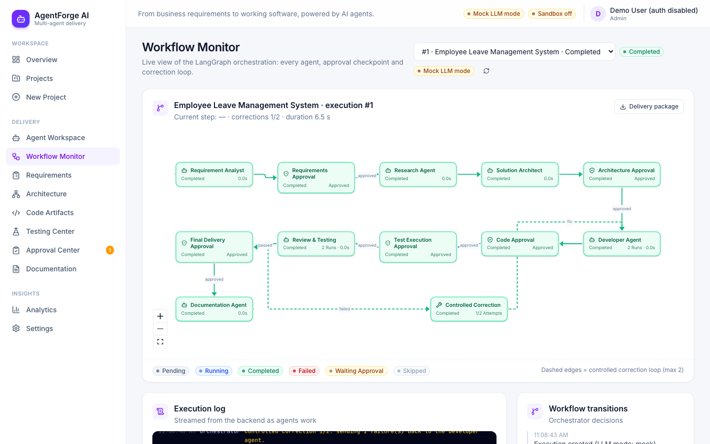
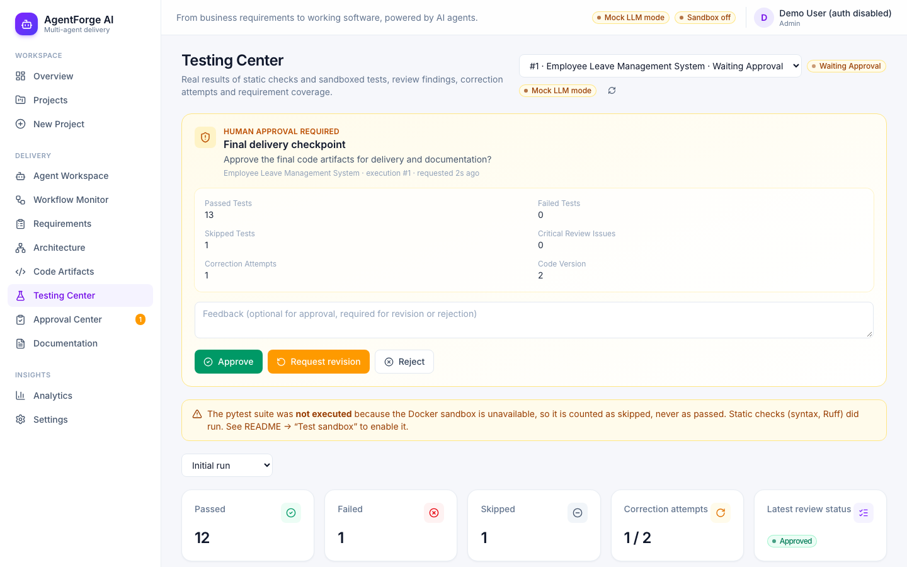
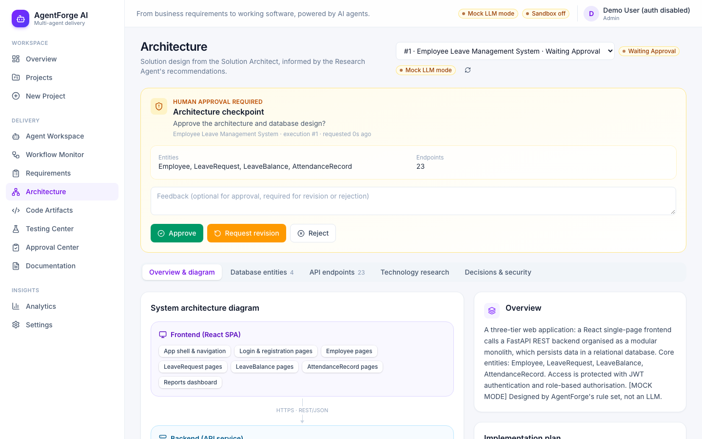
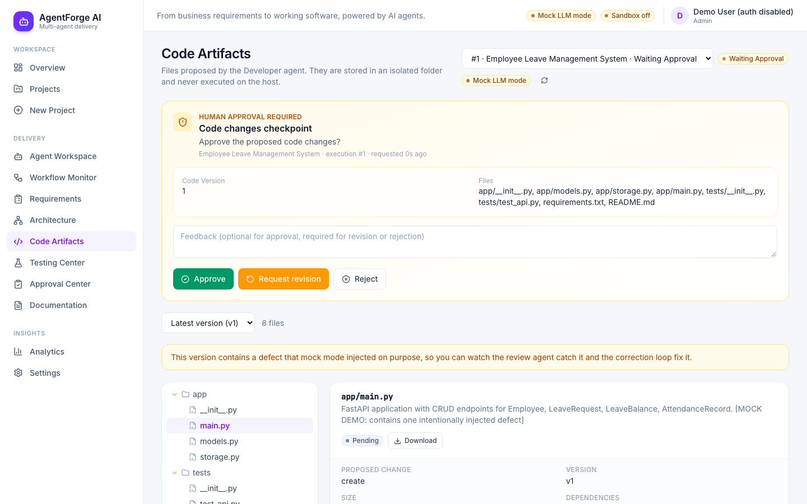
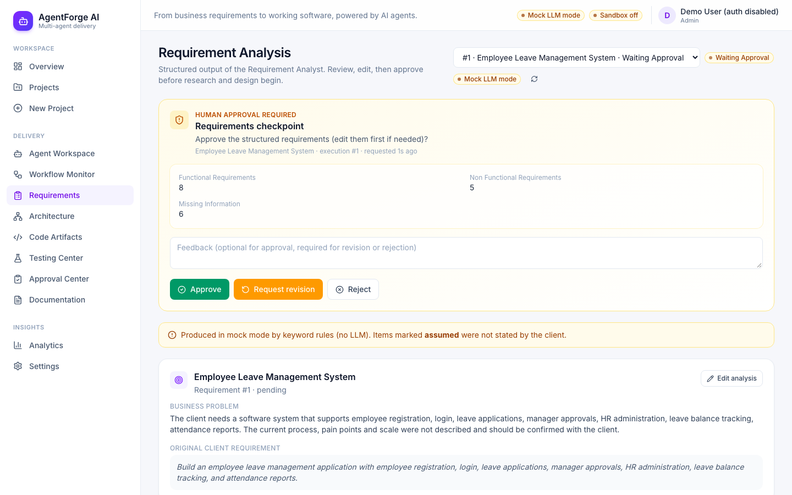
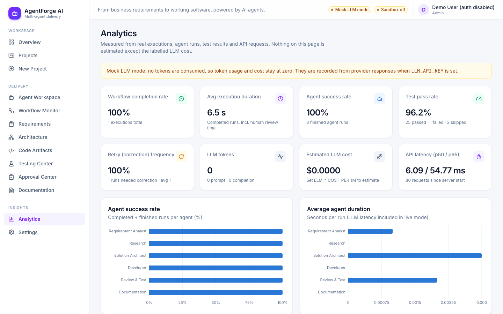

# AgentForge AI

> **From business requirements to working software, powered by AI agents.**

AgentForge AI is a multi-agent software engineering platform. A client describes what they need in plain language. Six specialised AI agents then work through it as a supervised team, orchestrated by **LangGraph** with shared state, checkpoints and human approvals:

```
Requirement Analyst → [approve] → Research → Solution Architect → [approve]
→ Developer → [approve code] → [approve test run] → Review & Testing
   ↺ controlled correction (max 2) when checks fail
→ [approve final delivery] → Documentation → delivery package (.zip)
```

Everything shown in the UI comes from real execution. Workflow states, agent timings, test results and analytics are all read from the database. Nothing is hard-coded.

---

## Highlights

| Area | What is implemented |
|---|---|
| **Multi-agent orchestration** | LangGraph `StateGraph` with a typed shared state, conditional routing, a bounded correction loop, and SQLite checkpoints. Paused workflows survive server restarts. |
| **Six agents** | Each agent has its own system prompt, a Pydantic output schema, validation rules, a retry policy with error feedback, token accounting, duration tracking and error capture. |
| **Human-in-the-loop** | Five checkpoints (requirements, architecture, code, test execution, final delivery). Each supports approve, request revision (with feedback) and reject, and records reviewer and timestamp. |
| **Real testing** | Static checks (Python `ast` and Ruff) always run. Generated pytest suites run **only** in a locked-down Docker sandbox. Without Docker they are reported as *skipped*, never as passed. |
| **Honest mock mode** | With no API key, agents use transparent rule-based logic. All output is labelled *mock*, and the first code version contains a labelled, intentional defect so the correction loop can be demonstrated. |
| **Enterprise UI** | React + Tailwind dashboard with 13 screens: React Flow workflow graph, live logs, code viewer with syntax highlighting, Markdown docs, Recharts analytics. |
| **Security** | Optional JWT auth with RBAC, PBKDF2 password hashing, prompt-injection separation, path-traversal protection, rate limiting, body-size limits, audit logging. |
| **Quality** | 69 backend tests (pytest), 2 Playwright end-to-end tests covering the full demo, Ruff linting, Alembic migrations, GitHub Actions CI. |

---

## Screenshots

Captured automatically by the Playwright E2E test (mock mode, Employee Leave Management demo). All 14 steps are in [docs/screenshots](docs/screenshots).

| Workflow Monitor: LangGraph run with the correction loop | Testing Center: injected defect caught, final approval |
|---|---|
|  |  |
| **Architecture: human approval checkpoint** | **Code Artifacts: generated files awaiting review** |
|  |  |
| **Requirements: stated, inferred and assumed requirements** | **Analytics: metrics from real executions** |
|  |  |

---

## Quick start (local)

**Requirements:** Python 3.11+, Node.js 20+ (22 recommended). Docker is optional: it is needed only to execute generated tests in the sandbox.

### 1. Backend

```bash
cd backend
python3.11 -m venv .venv
source .venv/bin/activate              # Windows: .venv\Scripts\activate
pip install -r requirements-dev.txt
cp .env.example .env                   # edit if you have an LLM API key
alembic upgrade head                   # create the database tables
uvicorn app.main:app --reload          # http://localhost:8000/docs
```

### 2. Frontend (new terminal)

```bash
cd frontend
npm install
npm run dev                            # http://localhost:5173
```

Open **http://localhost:5173**, click **New Project → Employee Leave Management → Continue ×3 → Create & start agents**, then follow the approvals. The [demo guide](documentation/demo-guide.md) has the full walkthrough.

### 3. (Optional) Real LLM agents

Edit `backend/.env`, then restart the backend:

```env
LLM_API_KEY=sk-...                     # any OpenAI-compatible provider
LLM_BASE_URL=https://api.openai.com/v1
LLM_MODEL=gpt-4o-mini
LLM_INPUT_COST_PER_1M=0.15             # verify current prices with your provider
LLM_OUTPUT_COST_PER_1M=0.60
```

The top bar switches from **Mock LLM mode** to **Live · model-name**, and token usage and estimated cost appear in Analytics.

**Google Gemini** (free tier, used for the verified live runs) works through its OpenAI-compatible endpoint:

```env
LLM_API_KEY=your-gemini-key            # from Google AI Studio
LLM_BASE_URL=https://generativelanguage.googleapis.com/v1beta/openai
LLM_MODEL=gemini-3.1-flash-lite
LLM_TIMEOUT_SECONDS=180
```

Reasoning models such as `gemini-3.6-flash` spend part of the output budget on hidden "thinking" tokens, which can truncate the Developer agent's large JSON answer. Set `LLM_REASONING_EFFORT=low` for these models. The client reports truncation explicitly, and it retries provider overload and rate-limit errors (429/5xx) with backoff.

### 4. (Optional) Test sandbox

Install Docker Desktop, then build the sandbox image once:

```bash
docker build -t agentforge-sandbox:latest -f docker/sandbox.Dockerfile docker
```

With `SANDBOX_MODE=auto` (the default), the backend detects the image and runs generated tests inside it. The container has no network access, runs as a non-root user on a read-only filesystem with CPU, memory and process limits, and is killed if it exceeds its timeout.

### Run everything with Docker Compose

```bash
docker compose up --build              # http://localhost:8080
```

In Compose the sandbox is disabled on purpose, because it would require mounting the Docker socket. See [deployment](documentation/deployment.md).

---

## Testing

```bash
cd backend && source .venv/bin/activate
ruff check .                           # lint
pytest                                 # 69 tests: API, workflow, agents, security
alembic check                          # models and migrations in sync

cd ../frontend
npx playwright install chromium        # first time only
npm run test:e2e                       # full demo flow in a real browser
```

Details: [documentation/testing.md](documentation/testing.md).

---

## Project structure

```
.
├── backend/
│   ├── app/
│   │   ├── main.py               # app assembly (middleware, routers, error handlers)
│   │   ├── config.py             # typed settings from environment variables
│   │   ├── database.py           # engine, sessions (SQLite FK + WAL pragmas)
│   │   ├── dependencies.py       # current user, RBAC, rate limiting
│   │   ├── models/               # 9 SQLAlchemy tables
│   │   ├── schemas/              # Pydantic request/response models
│   │   ├── routes/               # thin HTTP layer
│   │   ├── services/             # business logic, LLM client, sandbox, artifact store, docs
│   │   ├── agents/               # 6 agents + output schemas + mock-mode logic
│   │   ├── orchestration/        # LangGraph state, graph, runner, recorder
│   │   ├── prompts/              # system prompts + untrusted-data wrapping
│   │   └── middleware/           # error format, latency metrics, body limit
│   ├── alembic/                  # migrations
│   └── tests/                    # pytest suite
├── frontend/
│   ├── src/{pages,components,layouts,context,hooks,services,utils}
│   └── e2e/                      # Playwright tests
├── docker/                       # backend, frontend (nginx), sandbox images
├── documentation/                # architecture, agents, API, security, demo guide…
├── generated_projects/           # generated code & documents (git-ignored)
├── .github/workflows/ci.yml
└── docker-compose.yml
```

## Documentation

| Document | Contents |
|---|---|
| [requirements.md](documentation/requirements.md) | Problem statement, business, functional and non-functional requirements |
| [architecture.md](documentation/architecture.md) | System architecture, workflow graph, data model, design decisions |
| [agents.md](documentation/agents.md) | Each agent's responsibilities, inputs, outputs and validation |
| [api.md](documentation/api.md) | REST API reference (interactive version at `/docs`) |
| [security.md](documentation/security.md) | Security design and responsible-AI controls |
| [testing.md](documentation/testing.md) | Test strategy and how to run each suite |
| [deployment.md](documentation/deployment.md) | Docker, Compose, CI and production checklist |
| [demo-guide.md](documentation/demo-guide.md) | Interview demo script, talking points, resume bullets |
| [limitations-and-roadmap.md](documentation/limitations-and-roadmap.md) | Known limitations and future enhancements |

---

## Development progress

- [x] **Week 1 — Foundation:** repo, FastAPI, config, SQLAlchemy models, Alembic, project and requirement APIs, React dashboard, project wizard
- [x] **Week 2 — Multi-agent intelligence:** LLM client, six agents with schemas and retries, LangGraph state and orchestration, workflow monitor, live logs
- [x] **Week 3 — Validation & automation:** review and testing agent, static checks, Docker sandbox runner, conditional routing, controlled correction, five approval checkpoints
- [x] **Week 4 — Delivery:** documentation agent and 11 delivery documents, artifact storage and zip export, analytics, Dockerfiles, Compose, CI, Playwright E2E, documentation

**Verified in this environment:** backend tests (69), lint, migrations, frontend build, Playwright E2E (2), a live-server run including a restart while a workflow was paused for approval, all three Docker images, the Compose stack (through nginx), and the Docker sandbox. In the sandbox run, generated pytest caught the injected defect (25 passed, 1 failed), and all 26 passed after correction. A hostile test file confirmed there is no network, the filesystem is read-only, the user is non-root, and no host secrets are visible.
**Live LLM:** full workflows verified end-to-end on Google Gemini (`gemini-3.1-flash-lite`) through its OpenAI-compatible endpoint, with generated tests executed in the Docker sandbox. The first live run exposed an unnecessary correction loop that degraded working code. It was fixed with a regression guard, and automatic correction now runs only on real test failures (see the commit history).
